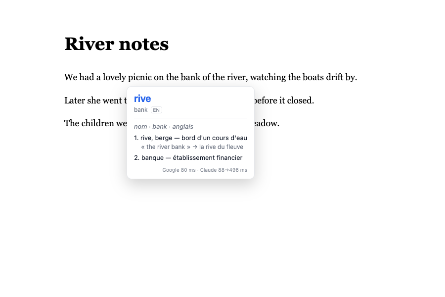

# Hover Translate

Extension Chrome (Manifest V3) : maintenez **Alt / Option ⌥** et survolez un mot. Une pop-up affiche :

- en titre, la **traduction courte**, choisie selon le sens de la phrase ;
- en dessous, une **entrée de dictionnaire** : catégorie grammaticale, sens numérotés, exemples.



## Pourquoi c'est rapide

Deux moteurs partent **en parallèle** dès que le mot est détecté :

| Moteur | Rôle | Latence | Coût |
|---|---|---|---|
| Google Translate (endpoint public, sans clé) | titre instantané + mini-dictionnaire | ~50–200 ms | gratuit |
| LLM en streaming (Claude Haiku 5.5 par défaut, ou OpenAI) | traduction **contextuelle** + entrée de dictionnaire | 1er mot ~300–600 ms | une fraction de centime par mot |

Le titre de Google s'affiche tout de suite. La première ligne du LLM le remplace dès qu'elle arrive, car elle tient compte de la phrase : « bank » donne *rive* au bord d'une rivière, mais *banque* pour un dépôt de salaire. Les requêtes sont annulées quand la souris passe à un autre mot, et les résultats sont mis en cache (mot + phrase). Les temps mesurés s'affichent en bas de la pop-up.

Sans clé API, l'extension fonctionne quand même : Google seul fournit la traduction et la liste des sens.

## Installation (mode développeur)

1. Ouvrez `chrome://extensions`.
2. Activez le **Mode développeur** (interrupteur en haut à droite).
3. Cliquez sur **Charger l'extension non empaquetée** et choisissez ce dossier (celui qui contient `manifest.json`).
4. Épinglez l'icône « Aa » si vous voulez y accéder facilement : un clic dessus ouvre les réglages.

Après une modification du code, cliquez sur ↻ sur la carte de l'extension dans `chrome://extensions`, puis **rechargez l'onglet** de test. Les onglets déjà ouverts n'ont pas le script.

## Configuration

Dans les réglages (clic sur l'icône) :

- **Touche à maintenir** : Alt (par défaut), Ctrl, Maj, Cmd, ou aucune.
- **Raccourci bascule** : `Alt+Shift+T` active ou désactive le mode survol sans avoir à tenir de touche. Échap quitte. Pour le changer, allez sur `chrome://extensions/shortcuts`.
- **Langue cible** : `fr` par défaut (celle du navigateur).
- **Moteur IA** : Claude ou OpenAI, avec la clé API et le modèle.
  - Clé Anthropic : <https://console.anthropic.com> → API Keys. Modèle conseillé : `claude-haiku-5-5`, le plus rapide.
  - Clé OpenAI : <https://platform.openai.com/api-keys>. Prenez un petit modèle rapide.
- **Tester avec « bank »** : vérifie la clé et affiche les latences réelles.

Les clés sont stockées dans `chrome.storage.local`, sur cette machine uniquement (pas de synchronisation), et ne sont envoyées qu'au fournisseur choisi.

## Utilisation

- Maintenez Alt et survolez un mot. Vous pouvez relâcher : la pop-up reste affichée tant que la souris est proche.
- Pour traduire une **expression**, sélectionnez-la puis survolez la sélection avec Alt.
- Éloignez la souris, faites défiler la page, cliquez ailleurs ou appuyez sur Échap pour fermer.

## Tests

```bash
npm install
npx playwright install chromium
npm test
```

`test/e2e.mjs` charge l'extension dans un Chromium automatisé, puis vérifie plusieurs comportements : survol avec Alt, rendu du titre et du dictionnaire, contexte transmis, cache, mode bascule, Google seul, et erreur 401 de la vraie API Anthropic avec une clé invalide. Le LLM est remplacé par un serveur local qui imite le streaming SSE d'Anthropic, ce qui évite d'avoir besoin d'une clé. Les captures sont écrites dans `test/output/`.

## Structure

```
manifest.json
src/background.js   service worker : Google + LLM en streaming, cache, raccourci
src/content.js      détection du mot (Intl.Segmenter), pop-up en Shadow DOM
src/options.*       page de réglages
src/settings.js     valeurs par défaut partagées
```

## Limites connues

- Les champs de saisie (`input`, `textarea`) et les PDF intégrés ne sont pas pris en charge.
- Les pages `chrome://` et le Chrome Web Store n'acceptent pas les scripts d'extension.
- L'endpoint Google utilisé n'est pas une API officielle : il peut changer. Le LLM prend alors le relais.
